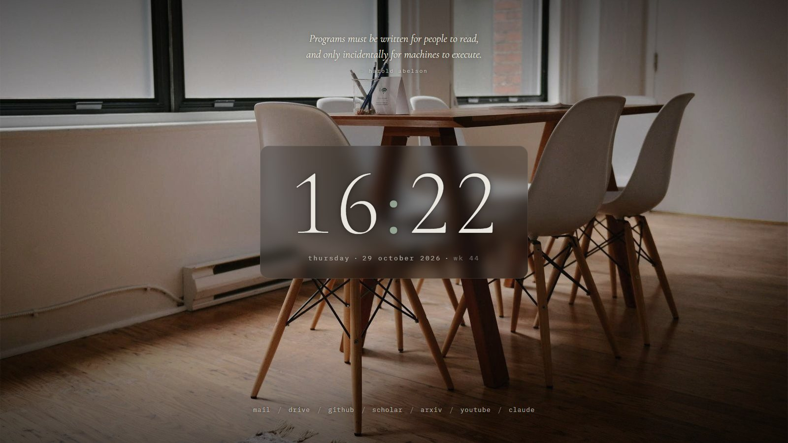
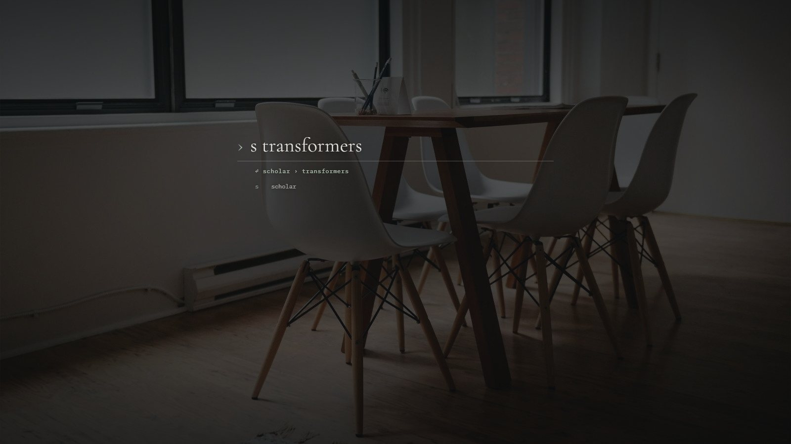
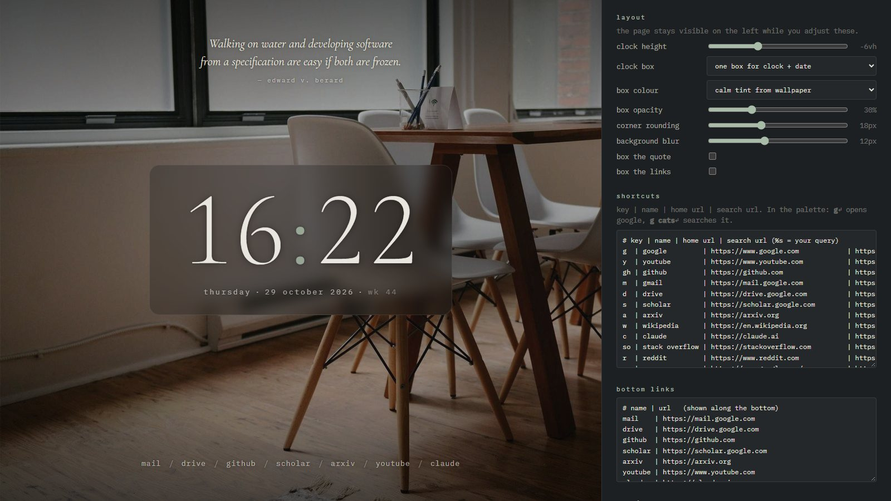
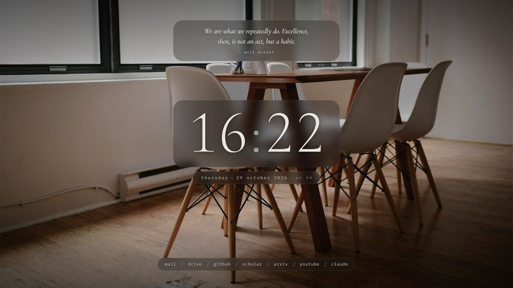
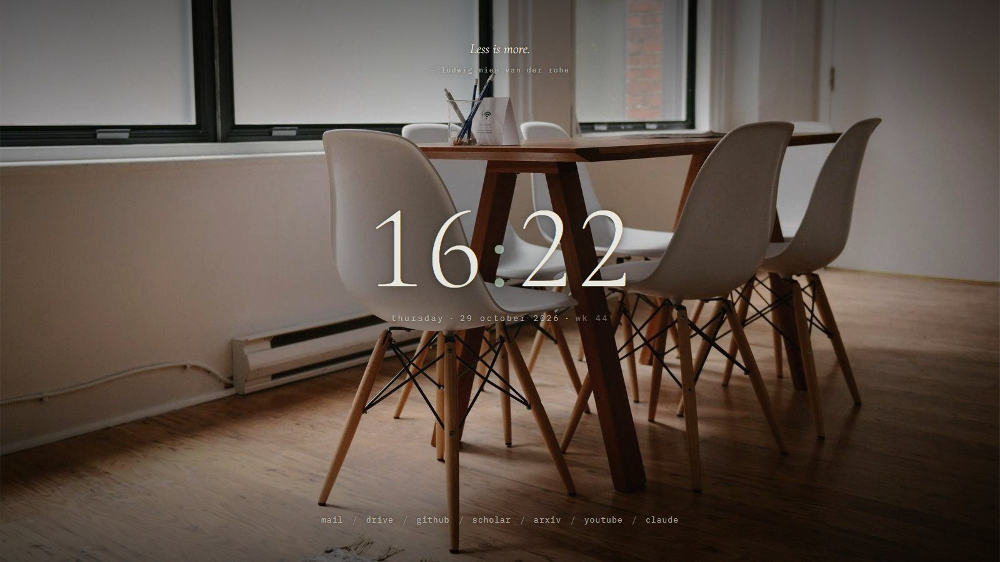
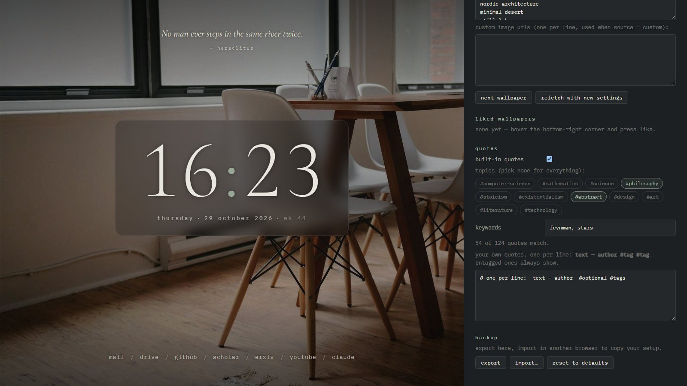

# startpage

A quiet new-tab page for Chrome, Edge and Brave: a 24-hour clock, a quote, soft
wallpapers, a command palette and a small file terminal. Plain HTML/CSS/JS,
with no framework and no background process.



## Install (same steps in all three browsers)

Keep the code in one fixed place that you won't move, e.g. a clone of the private repo:

```
git clone https://github.com/sushanthg1711/startpage.git %USERPROFILE%\startpage
```

1. Open `chrome://extensions`, `edge://extensions` or `brave://extensions`.
2. Turn on **Developer mode**.
3. Click **Load unpacked** and pick the folder.
4. Open a new tab. If the browser asks whether to keep the changed new-tab page, choose **Keep**.

To show it on startup as well, set the browser to *"Open the New Tab page"* on startup.

The `key` in `manifest.json` pins the extension ID to `jaminnpimnodmmedgjheohocdngijgpm` in every
browser, wherever the folder lives. Browsers load an unpacked extension from its folder each time, so
if you move the folder, click **Load unpacked** again and pick the new place. Because the ID stays the
same, your settings carry over. Export settings first anyway, to be safe.

**Update:** run `git pull` in the folder, then click the reload arrow on the extension's card (or restart the browser).

**Brave only:** the terminal needs folder access, which Brave turns off by default.
Enable `brave://flags/#file-system-access-api` and restart Brave.

## Keys

| key | does |
| --- | --- |
| `Tab` or `/` | open the palette |
| `Ctrl` + `` ` `` or `Shift+Tab` | open the terminal (`Ctrl+Tab` belongs to the browser, so pages can't use it) |
| `Esc` | close whatever is open |

A new tab starts with the cursor in the browser's address bar, which stays empty. Type there to
search, or click the page to use the keys above. To have `Tab` work at once, turn on
**settings → grab focus**. The address bar then shows the extension's `chrome-extension://…` url.
Browsers don't let an extension change that text.

### Palette

- `g` ↵ opens Google; `g cats` ↵ searches Google. `y`, `gh`, `s` (scholar), `a` (arXiv), `c` (Claude) and others work the same way.
- `Tab` / `↑↓` cycle the suggestions. `Ctrl+Enter` opens the result in a new tab.
- `arxiv.org` ↵ opens the site. Any other text searches with your default engine.
- `2*pi`, `sqrt(2)/3` and similar show the answer; ↵ copies it.
- `:next`, `:like`, `:term`, `:settings`.



### Terminal

Run `mount` once for each folder you want to browse (Desktop, MTech, …). They become
`~/desktop`, `~/mtech` and so on. After that:

- `Tab` on an empty line cycles `cd desktop` → `cd mtech` → …
- `ls`, `ls -l`, `cd`, `cd ..`, `cd -`, `cat`, `open file.pdf`, `find *.pdf`, `tree 3`, `places`, `umount`
- Typing a place name alone (`mtech`) jumps there. Click any name to cd into it or open it.
- Shortcut keys work here too: `g transformers`.

It is read-only and runs inside the browser sandbox, so it cannot launch programs or run real shell commands.

## Wallpapers

Images are downloaded in the background, cropped to your screen, softened once
(desaturated and dimmed, baked into the pixels) and cached. Each new tab only
loads a small local JPEG.

Hover the **bottom-right corner** for `like` / `dislike` / `next`.
- **like**: saved locally; liked wallpapers come back in a share of new tabs (*liked share* in settings).
- **dislike**: removed and never shown again. Fresh images never repeat.

Sources, tried in order when set to *auto*:
- **Unsplash**: the best quality and the most "minimal" results. Create a free app at
  <https://unsplash.com/developers> and paste its *Access Key* in settings.
  Themes come from the *search themes* list (e.g. `fog mountains`, `nordic architecture`).
- **Wallhaven**: large curated library, filtered towards soft grey, green and blue colours. (It wasn't reachable on the network this was built on.)
- **Picsum**: always works with no setup, but images are random.
- **Custom**: your own list of image URLs.

## Settings

Hover the **bottom-left corner** and click `settings`, or type `:settings` in the palette.
Changes save as you type. While settings is open, the page moves to the left of the panel
so you can watch each change as you make it.

### Layout



| setting | what it does |
| --- | --- |
| clock height | moves the clock and date up (negative) or down, in % of the screen height |
| clock box | one box around clock + date, a separate box for each, or none |
| box colour | *calm tint from wallpaper*: the wallpaper's hue, desaturated and kept dark. *neutral dark*: always the same grey |
| box opacity | how solid the box is |
| corner rounding | 0 for square corners, 48 for a pill shape |
| background blur | frosted-glass blur behind the box |
| box the quote / links | gives the quote and the bottom links a box too, which helps on bright wallpapers |

| separate boxes, quote and links boxed | no boxes |
| --- | --- |
|  |  |

### Quotes



Pick topics (`#computer-science`, `#mathematics`, `#philosophy`, `#stoicism`, `#abstract`,
`#art`, …) and/or type keywords (`feynman, stars, #zen`). A quote shows if it has any chosen
topic or contains any keyword. The count under the keywords says how many match. Pick nothing to see
every quote. Add your own as `text — author #tag #tag`. Your quotes without tags always show.

### Everything else

Shortcuts, bottom links, terminal places and wallpaper options are plain text or simple controls.
Use **export / import** under *backup* to copy your setup to another browser.
